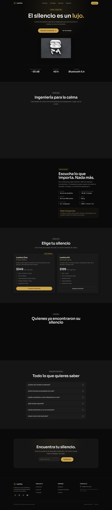

# 🍎 Lumina — Landing Page

> **El silencio es un lujo.** — Landing page de marca para *Lumina*, auriculares premium con cancelación activa de ruido.

Landing page estática construida con **Astro 7 + Tailwind CSS v4 + TypeScript**, preparada para **Cloudflare Pages**. Forma parte de la serie de 9 landing pages por estilo de diseño (este proyecto: **Minimalismo / estilo Apple**).




---

## 🚀 Demo en producción

| Recurso | URL |
|---|---|
| Producción (Cloudflare Pages) | `https://lumina.stevemoya.me` *(cuando conectes el repo)* |
| Preview Pages | `https://landing-lumina.pages.dev` |

---

## 🧱 Stack

- **Astro 7** — SSG con output `hybrid` (listo para añadir Cloudflare Functions si se necesita un backend en el futuro)
- **Tailwind CSS v4** — tokens de diseño de marca en `src/styles/global.css` (`@theme`)
- **TypeScript 5** — estricto (`astro/tsconfigs/strict`)
- **Adaptador `@astrojs/cloudflare`** + **`@astrojs/sitemap`**
- **Fontsource** — fuentes `Sora Variable` (display) e `Inter Variable` (body) auto-hospedadas, `font-display: swap`
- **JavaScript mínimo** — solo 3 scripts pequeños (~2 KB totales): header/menú móvil, reveal on scroll y validación del newsletter

## 📁 Arquitectura

```
src/
├── components/
│   ├── ui/          → primitivas reutilizables (Button, Card, Badge, Icon, Input, Section, Container, Link)
│   ├── layout/      → Header, Navigation, MobileMenu, Footer
│   ├── sections/    → secciones de la página (Hero, Features, Showcase, Products, Testimonials, FAQ, CTA)
│   └── brand/       → Logo, ProductVisual (ilustración SVG del producto)
├── data/            → TODO el contenido tipado, separado de la presentación
│   ├── site.ts      → marca, nav, hero, footer, sociales, contacto
│   ├── features.ts  ├── showcase.ts  ├── products.ts
│   ├── testimonials.ts └── faqs.ts
├── layouts/BaseLayout.astro  → SEO + Open Graph + Twitter Cards + JSON-LD + skip-link
├── pages/           → index.astro, 404.astro
├── scripts/         → header.ts, reveal.ts, newsletter.ts (islas JS mínimas)
└── styles/global.css → Design System: tokens @theme + base + utilidades de marca
public/
├── _headers        → CSP + security headers para Cloudflare Pages
├── favicon.svg     → favicon de marca (SVG)
└── robots.txt      → sitemap incluido
```

**Principios:**

- **Contenido ≠ presentación**: editar `src/data/*.ts` cambia el sitio sin tocar componentes.
- **Componentización sin sobreabstracción**: primitivas configuradas por props; secciones específicas de la marca viven en `sections/`.
- **Cero imágenes rasterizadas**: todo el visual es SVG/CSS → LCP instantáneo, sin requests de imagen.
- **Mobile-first** con jerarquía consistente en 4 breakpoints.
- **Animaciones CSS-first** (`prefers-reduced-motion` respetado; reveal con IntersectionObserver como isla mínima).

## 🎨 Design System (resumen)

| Token | Valor | Uso |
|---|---|---|
| `stone` | `#0A0A0A` | fondo principal |
| `ink` | `#151515` | fondo alterno de secciones |
| `graphite` | `#1E1E1E` | surfaces / cards |
| `silver` | `#A3A3A3` | texto secundario / bordes |
| `cloud` | `#F5F5F4` | texto primario |
| `aurum` | `#C9A24B` | **único acento** (CTA, detalles) |
| `aurum-soft` | `#D9B866` | hover del acento |

- Tipografías: **Sora** (display) + **Inter** (body), escala 4 tamaños.
- Spacing: grid de 8 px · radius: 16 px (cards) / pill (botones) · sombras suaves.
- Estados definidos para hover / focus (anillo aurum) / active / disabled.
- Accesibilidad: WCAG AA, skip-link, headings semánticos, `aria` en iconos y menú móvil, focus visible.

## 🛠️ Scripts

```bash
pnpm install        # instalar dependencias
pnpm dev            # servidor de desarrollo → http://localhost:4321
pnpm build          # build de producción → dist/
pnpm preview        # previsualizar el build localmente
pnpm check          # chequeo de tipos + astro check
pnpm astro check    # chequeo específico de Astro
```

## 🔐 Variables de entorno

**Ninguna requerida.** La landing es 100 % estática. Si en el futuro añades un formulario con backend (Cloudflare Function), las variables irán en `.dev.vars` local y en el dashboard de Pages (Production/Preview).

## ☁️ Deploy en Cloudflare Pages

### Opción A — Dashboard (recomendada, sin credenciales locales)

1. Ve a [dash.cloudflare.com](https://dash.cloudflare.com) → **Workers & Pages** → **Create** → **Pages** → **Connect to Git**.
2. Selecciona el repo `landing-lumina` (GitHub).
3. Configuración de build:

   | Campo | Valor |
   |---|---|
   | Framework preset | `Astro` |
   | Build command | `pnpm build` |
   | Build output directory | `dist` |
   | Node version | 22+ |

4. Deploy. El primer build genera `landing-lumina.pages.dev`.
5. **Dominio personalizado**: Project → Custom domains → `lumina.stevemoya.me` (CNAME en Cloudflare DNS, proxied).

> Los commits a `main` despliegan automáticamente; cada PR genera un preview.

### Opción B — CLI (opcional)

```bash
pnpm dlx wrangler login
pnpm dlx wrangler pages deploy dist --project-name=landing-lumina
```

## 🛡️ Seguridad

- `public/_headers`: CSP estricta (`default-src 'self'`), `X-Frame-Options: DENY`, `X-Content-Type-Options: nosniff`, `Referrer-Policy`, `Permissions-Policy`, HSTS.
- `security.checkOrigin: true` en Astro.
- Sin secretos en el repo (solo `.env`/`.dev.vars` en `.gitignore`).

## 📝 Decisiones de implementación

- **Sin CMS**: contenido versionado en Git (`src/data/`). Si algún día se quiere editar sin deploy, migrar a un CMS headless tocando solo `src/data`.
- **Output `hybrid`**: estático hoy, sin cambios de config si mañana se añade una API route.
- **Visuales 100 % SVG/CSS**: las marcas son ficticias; los mockups UI se construyen en código (rápido, ligero, coherente).
- **Formulario newsletter sin backend**: valida en cliente y muestra éxito; integra tu ESP favorito (Buttondown, Mailchimp, Resend…) en `src/scripts/newsletter.ts` cuando haya backend.
- **CTAs de compra (`#`)** son placeholders de checkout.

## 🧪 QA

```bash
pnpm check   # tipos + astro check
pnpm build   # build limpio
```

Verificado: build exitoso, HTML semántico, SEO completo (title/description/OG/Twitter/canonical/sitemap/robots/JSON-LD), accesibilidad AA, Core Web Vitals friendly (sin JS de terceros, fuentes optimizadas, cero imágenes rasterizadas).

---

© 2026 Lumina — Proyecto de portafolio de Steve Moya.
